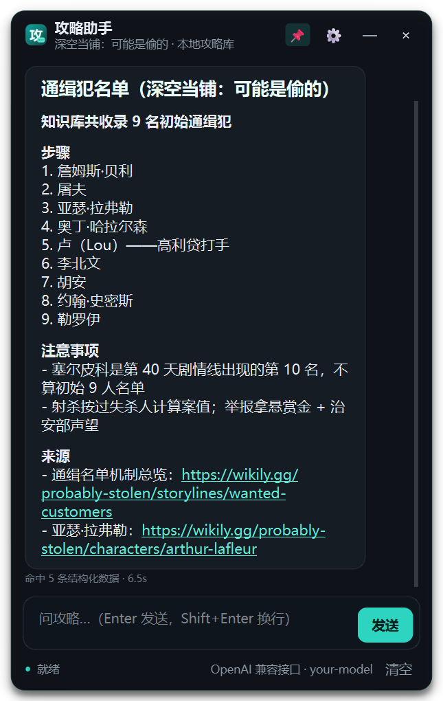

# 游戏攻略助手（Game Guide Assistant）

把单机游戏攻略变成可查询的本地知识库，并在游戏里用一个**置顶悬浮窗**直接问。
首版游戏：**《深空当铺：可能是偷的》/ Probably Stolen**（Steam appid 4348910）。



- **两个 Skill 双主力**：`game-kb-builder` 负责**建库**，`game-guide-qa` 负责**问答**
- **建库管线**：源探测 → 分源采集 → 结构化 → MCP 查询 → 装机验证；公开版带 Steam/Wikily/游民自动采集器，本地完整版另有 B站登录态与小黑盒（黑盒）签名中继采集
- **悬浮窗**：置顶、半透明、可拖拽缩放，`F8` 全局显示/隐藏，不切屏问攻略
- **只依据知识库回答**：按「前置条件 / 步骤 / 注意事项 / 来源」给答案；查不到就说“知识库暂未收录”，不编造
- **来源可点击**：答案里的 http(s) 网址自动变成可点击链接
- **MCP 服务器**：5 个查询工具，ZCode / 任意 MCP 客户端可接
- **知识库外挂**：exe 不内置攻略数据，读取外部 `output/` 目录；MCP 与悬浮窗共用同一份

> **先看建库 Skill**：这个项目最核心的能力是
> [`skills/game-kb-builder/SKILL.md`](skills/game-kb-builder/SKILL.md)。
> 它教你把任意游戏的公开攻略变成结构化知识库：先探测源、再采集、再补数据、
> 最后用 MCP 和问答 Skill 验证。完整拆解见
> **[game-kb-builder 功能与实现详解](docs/skill-game-kb-builder.md)**。
>
> **再看问答 Skill**：[`skills/game-guide-qa/SKILL.md`](skills/game-guide-qa/SKILL.md)
> 规定查库顺序、答案格式、列表报数量、剧透警告和拒答规则。见
> **[game-guide-qa 功能与实现详解](docs/skill-game-guide-qa.md)**。

> **公开版说明**：本仓库包含 **135 条结构化攻略数据**、查询层、MCP 服务器、两个 Skill、
> 悬浮窗代码，以及 **Steam / Wikily / 游民星空的公开源采集管线**；
> **不包含** 696 篇第三方攻略全文、B站登录态采集器和小黑盒签名中继采集器（版权/平台条款原因）。
> 全文需要按来源 URL 自行采集；详见 [数据说明](output/deepspace-pawnshop/README.md)。

## 两个 Skill：一个建库，一个问答

| 角色 | Skill | 负责什么 |
|---|---|---|
| **建库主力** | `game-kb-builder` | 源探测、采集、结构化、查询层、装机验证；把攻略变成 `output/<game>/` |
| **问答主力** | `game-guide-qa` | 判断问题类型、调 MCP 工具、按固定格式回答、列表报数量、查不到拒答 |
| 工具层 | MCP | 5 个查询工具，把知识库能力暴露给 AI 客户端 |
| 数据层 | 知识库 | `output/<game>/data/*.json` + 可选 `guides/*.md` |
| 界面层 | 悬浮窗 | 游戏内 UI、快捷键、模型调用；复用问答 Skill 规则 |

### game-kb-builder：建库主力

它把“攻略”变成“可问答的数据”，分五阶段：

| 阶段 | 做什么 | 关键产物 |
|---|---|---|
| ① 源探测 | 先看每个源有没有货，不盲抓 | 源状态报告 JSON |
| ② 分源采集 | Steam / Wikily / 游民自动抓；手动源放 `guides/` | `output/<game>/guides/` |
| ③ 结构化抽取 | 按六类补齐前置/步骤/注意事项/来源 | `output/<game>/data/*.json` |
| ④ 查询层 | 结构化优先、全文兜底、按数据自动生成中英术语桥 | `kb/query.py` |
| ⑤ 装机验证 | MCP 冒烟 + 四问 + 反例 + 驾驶员验收 | 可问答的知识库 |

一条新游戏的端到端命令：

```bash
# 1. 探测
.venv\Scripts\python.exe scripts\probe_sources.py --name "游戏名" --name-en "Game" --appid 123456
# 2. 写 games/<slug>.json
# 3. 自动采集（Steam/Wikily/游民）
.venv\Scripts\python.exe scripts\build_kb.py --game <slug>
# 4. 按 data/*.json 规范补结构化条目
# 5. 回归
.venv\Scripts\python.exe scripts\test_mcp_smoke.py
```

建库硬规则：

- 每条数据必须有 `source_url` + `verified_date`；
- 列表/数量类内容必须回汇总页核对总数（9 名通缉犯、21 个成就）；
- 只采公开页面，尊重 robots.txt / 平台条款，不绕过登录和验证码；
- 不确定的内容宁可不收。

公开版自带：`scrapers/base.py`（缓存/限速/UA/robots）、`steam_guide.py`、`wikily.py`、
`ali213.py`、`scripts/probe_sources.py`、`scripts/build_kb.py`、`scripts/build_data.py`。
B站登录态和小黑盒签名中继不在公开版。

> 详细拆解（五阶段、源探测、游戏配置、数据 schema、坑表、扩源、排障）：
> **[docs/skill-game-kb-builder.md](docs/skill-game-kb-builder.md)**

### game-guide-qa：问答主力

它解决的是“有工具但不会用”的问题。没有它，模型容易：

- 凭训练记忆编数值（价格、天数、悬赏金额）
- 只搜到 1 个通缉犯就说“全部就这些”
- 用自己习惯的格式回答，来源缺失
- 直接剧透结局
- 知识库没有也硬答

#### 一次问答的完整链路

以「通缉犯有哪几个？」为例：

1. Skill 判断这是**列表/数量类问题**，触发列表硬规则。
2. 调 `list_games` 确认游戏已收录。
3. 调 `search_data(game, "通缉犯")` 搜结构化数据（中英术语桥会自动扩展到 `wanted`）。
4. 命中「通缉名单机制总览」等条目；必要时 `get_entry` 取整条。
5. 调 `search_guides` 做全文兜底，中英文各搜一次。
6. 按固定格式回答：前置条件 / 步骤 / 注意事项 / 来源；写明「知识库共收录 9 名初始通缉犯」。
7. 如果两边都没命中，回答「知识库暂未收录」，不调模型编造。

#### MCP 工具表

| 工具 | 作用 |
|---|---|
| `list_games` | 确认游戏是否收录、有哪些分类、数据量 |
| `search_data` | 按关键词搜结构化数据；可按分类过滤 |
| `get_entry` | 按名称/id 取整条数据（前置条件、步骤、注意事项、来源） |
| `search_guides` | 全文检索攻略库，返回命中文件与行号 |
| `get_guide` | 读取指定攻略全文 |

#### 为什么悬浮窗也用同一份 Skill

悬浮窗的 `overlay/core/prompt.py` 会在启动时读取 `skills/game-guide-qa/SKILL.md`，
去掉 frontmatter 后注入系统提示词；`overlay/core/kb_bridge.py` 先替模型完成检索，
把命中的结构化条目和全文摘录放进上下文。这样：

- ZCode 里：Skill 驱动模型调用 MCP 工具
- 悬浮窗里：Skill 作为系统提示词约束模型，检索由本地代码完成

两条路的**答案规则完全一致**：同样的格式、同样的列表数量要求、同样的拒答逻辑。

> 详细拆解（触发机制、frontmatter、实现代码、扩游戏/扩工具、排障）：
> **[docs/skill-game-guide-qa.md](docs/skill-game-guide-qa.md)**

## 快速开始

### 方式 A：下载 exe（Windows）

1. 到 [Releases](../../releases) 下载：
   - `GameGuideOverlay.exe`（单文件版）
   - `game-guide-assistant-kb.zip`（公开版结构化数据，解压后得到 `output/`）
   - 如果单文件版提示 `Could not create temporary directory!`，改下 `GameGuideOverlay-onedir.zip`，
     解压后运行里面的 `GameGuideOverlay.exe`
2. 把 exe 和 `output/` 放在**同一个目录**（onedir 版把 `output/` 放在 exe 旁边）。
3. 双击 exe，点右上角 **⚙ 设置 → 模型**：
   - 填 OpenAI 兼容的 Base URL（一般以 `/v1` 结尾）和 API Key
   - 点「拉取清单」选模型，点「保存此提供商」
4. 按 **F8** 显示/隐藏；关窗口只是缩到托盘。

> exe 不含攻略库，也不含任何 API Key。知识库目录也可以在「设置 → 知识库」里手动选。
> 如果你有本地完整攻略全文，把它放进同一个 `output/<game>/guides/`，同一个 exe 会自动使用。

### 方式 B：源码运行

```bash
python -m venv .venv
.venv\Scripts\pip install -r requirements-overlay.txt
.venv\Scripts\python overlay\main.py
```

默认使用项目里的 `output/`；没有配置 Key 也能启动，只是问答时会提示配置模型。

### 方式 C：在 ZCode 里用 MCP + 技能

1. 安装 MCP 依赖：

```bash
.venv\Scripts\pip install -r requirements.txt
```

2. 把 MCP 服务器注册到 ZCode（示例，路径换成你的实际路径）：

```json
{
  "mcp": {
    "servers": {
      "game-guide-kb": {
        "command": "C:\\path\\to\\python.exe",
        "args": ["C:\\path\\to\\game-guide-assistant\\mcp_server\\server.py"],
        "env": {
          "PYTHONUTF8": "1",
          "GGA_OUTPUT_DIR": "C:\\path\\to\\game-guide-assistant\\output"
        }
      }
    }
  }
}
```

3. 安装技能：把两个目录都复制到 ZCode 技能目录，然后重启 ZCode：

```text
skills/game-guide-qa/     →  %USERPROFILE%\.zcode\skills\game-guide-qa\
skills/game-kb-builder/   →  %USERPROFILE%\.zcode\skills\game-kb-builder\
```

之后在 ZCode 里：

- 问「通缉犯有哪几个？」→ `game-guide-qa` 自动调 MCP 工具回答
- 说「给 XX 游戏建攻略库」→ `game-kb-builder` 先跑源探测，按五阶段建库

### 方式 D：给新游戏建攻略库

```bash
.venv\Scripts\pip install -r requirements.txt
.venv\Scripts\python scripts\probe_sources.py --name "游戏名" --name-en "Game" --appid 123456
# 按探测报告写 games/<slug>.json
.venv\Scripts\python scripts\build_kb.py --game <slug>
# 按 output/<slug>/data/*.json 规范补结构化条目
# 每条尽量带 name（中文名）+ name_en（英文名）：查询层会自动生成中英术语桥
.venv\Scripts\python scripts\test_mcp_smoke.py
```

公开版自带 Steam / Wikily / 游民星空采集器；B站登录态、小黑盒签名中继不包含。
完整流程、数据 schema、坑表和扩源方法见
**[docs/skill-game-kb-builder.md](docs/skill-game-kb-builder.md)**。

## 架构

```
公开攻略来源（Steam / Wikily / 游民 / 手动源）
                  │
    ┌─────────────┴─────────────┐
    │  game-kb-builder（建库主力） │
    │  源探测→采集→结构化→验收    │
    └─────────────┬─────────────┘
                  │ 写
        output/<game>/  ← 唯一数据源
          data/*.json + guides/*.md
                  │
            kb/query.py  ← 查询核心
             │          │
   mcp_server/server.py  overlay/core/kb_bridge.py
             │          │
     ZCode + game-guide-qa   悬浮窗（同一份 SKILL.md 注入提示词）
```

- **game-kb-builder 是建库主力**：它决定“怎么把攻略变成库”。
- **game-guide-qa 是问答主力**：它决定“怎么查、怎么答、什么时候拒答”。
- 攻略库归 MCP：`output/` 是唯一数据源，MCP 和悬浮窗都读它。
- exe 只打包界面、查询客户端和技能规则，**不打包 `output/`**。
- 模型走 OpenAI 兼容接口；密钥只保存在本机 `%APPDATA%\GameGuideAssistant\overlay-config.json`。

## 已实现的功能

### 悬浮窗

- 无边框置顶窗口；拖标题栏移动，拖四边/右下角缩放
- 透明度 25%–100%、字号 11–22px、置顶开关，位置/大小/透明度持久化
- 全局快捷键可录制（默认 `F8`），注册失败会明确提示
- 系统托盘；单实例；本机健康端口 `127.0.0.1:8894/health`
- 流式回答、停止生成、连续追问、生成中清空
- 答案 Markdown 渲染；来源里的纯文本网址自动转可点击链接

### 模型配置

- 任意 OpenAI 兼容接口：`/v1/models` 拉清单、`/chat/completions` 流式对话
- 「测试连接」发一条最小请求
- 推理模型只返回 `reasoning_content` 时自动加倍 `max_tokens` 重试
- 多个提供商可保存、切换

### 问答规则

- 结构：`前置条件 / 步骤 / 注意事项 / 来源`
- 列表问题声明知识库收录数量；单条命中时提示“可能不全”
- 剧情/结局先给 `[剧透警告]`
- 数值只能来自知识库；版本和核对日期如实转述
- 没有命中：确定性回复「知识库暂未收录」，不调用模型编造

## 数据

| 分类 | 条数 |
|---|---:|
| 成就 | 21 |
| 危机/强敌 | 3 |
| 角色/通缉犯 | 14 |
| 道具 | 12 |
| 任务/事件 | 11 |
| 配方 | 74 |
| **合计** | **135** |

每条数据含 `source_url` 和 `verified_date`。来源包括 Steam 社区指南、Wikily.gg、
游民星空、B站专栏/视频字幕、小黑盒社区。

**公开版不含 696 篇攻略全文**，只保留结构化摘要与来源链接；全文采集请遵守各来源的
robots.txt / 服务条款，并只用于个人学习。

## 构建 exe

```bat
python -m venv .venv
.venv\Scripts\pip install -r requirements-overlay.txt -r requirements-build.txt
scripts\build_exe.bat
```

产物：`dist\GameGuideOverlay.exe`。

- 只打包 UI 代码、图标和 `skills/game-guide-qa` 规则，**不打包 `output/`**。
- 运行时按顺序查找知识库：`GGA_OUTPUT_DIR` → exe 同目录 `output/` → exe 上一级 `output/`
  → `%APPDATA%\GameGuideAssistant\output\` → 项目 `output/`。
- 打包成单文件 exe 会有 1–3 秒启动解压时间，属正常现象。

## 目录

```
overlay/                 PySide6 悬浮窗
  core/kb_bridge.py      问题清洗 → 检索 → 上下文（复用 kb/query.py）
  core/llm_client.py     OpenAI 兼容流式客户端
  core/prompt.py         注入 skills/game-guide-qa 规则
  core/hotkey.py         全局快捷键
  ui/                    窗口、聊天、设置
kb/                      查询核心（MCP 与悬浮窗共用）
mcp_server/server.py     fastmcp stdio 服务器（5 个工具）
skills/game-kb-builder/  建库技能（建库主力）
skills/game-guide-qa/    问答技能（问答主力）
scrapers/                公开源采集器（Steam/Wikily/游民）
games/                   游戏配置
output/<game>/data/      结构化攻略数据（公开版）
output/<game>/guides/    攻略全文（公开版不含，可自行补充）
scripts/                 源探测、建库、数据装配、翻译、冒烟、打包
docs/screenshots/        界面截图
docs/skill-game-kb-builder.md  Skill 建库功能与实现详解
docs/skill-game-guide-qa.md     Skill 问答功能与实现详解
```

## 隐私

- 仓库和 Release 里**没有** API Key、Cookie、聊天记录。
- 模型 Key 只存本机 `%APPDATA%\GameGuideAssistant\overlay-config.json`。
- 对话只保存在内存里，关程序即消失；没有遥测、没有云端上传。
- 查询时只把命中的攻略片段发给用户自己配置的 LLM。

## 已知限制

- **独占全屏**（DirectX exclusive fullscreen）游戏通常盖不住，请改成「无边框窗口 / 窗口化」。
- 只支持 OpenAI 兼容接口；Anthropic 原生格式未接。
- 公开版没有攻略全文，`search_guides`/`get_guide` 会返回空；结构化问答不受影响。
- 攻略数据有版本和时效，回答会带 `verified_date`；游戏更新后可能需要重采。
- Windows 全局快捷键注册成功不代表物理按键一定触发（受前台锁/其他软件占用影响），需要真人验证。
- 单文件 exe 在个别磁盘/杀软环境下可能报 `Could not create temporary directory!`：
  改用 onedir 版，或把 exe 移到 `C:` / `E:` 等本地固定盘再运行。

## 数据来源与版权

代码以 MIT 协议开源；`output/` 里的结构化数据由公开攻略页面整理，版权归原作者/平台。
第三方攻略全文不随仓库分发。详见 [NOTICE.md](NOTICE.md)。

## License

[MIT](LICENSE)（仅代码；第三方攻略内容见 NOTICE）
